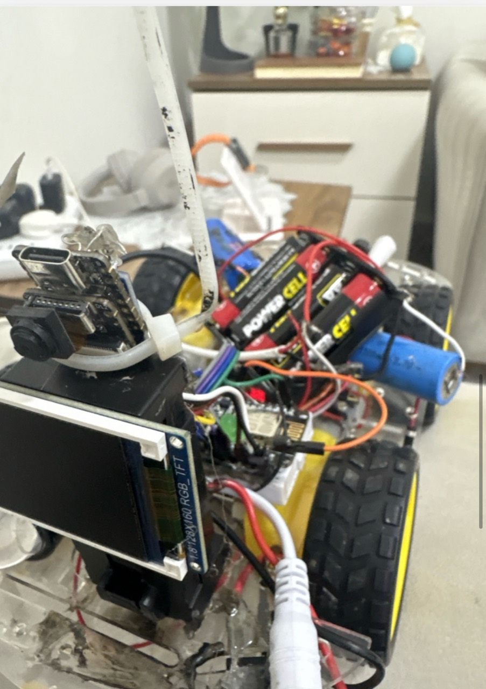
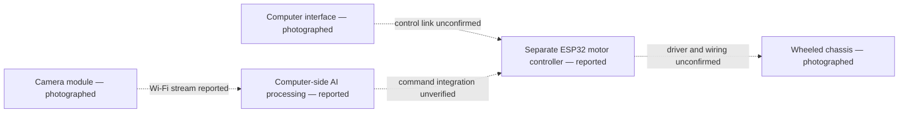
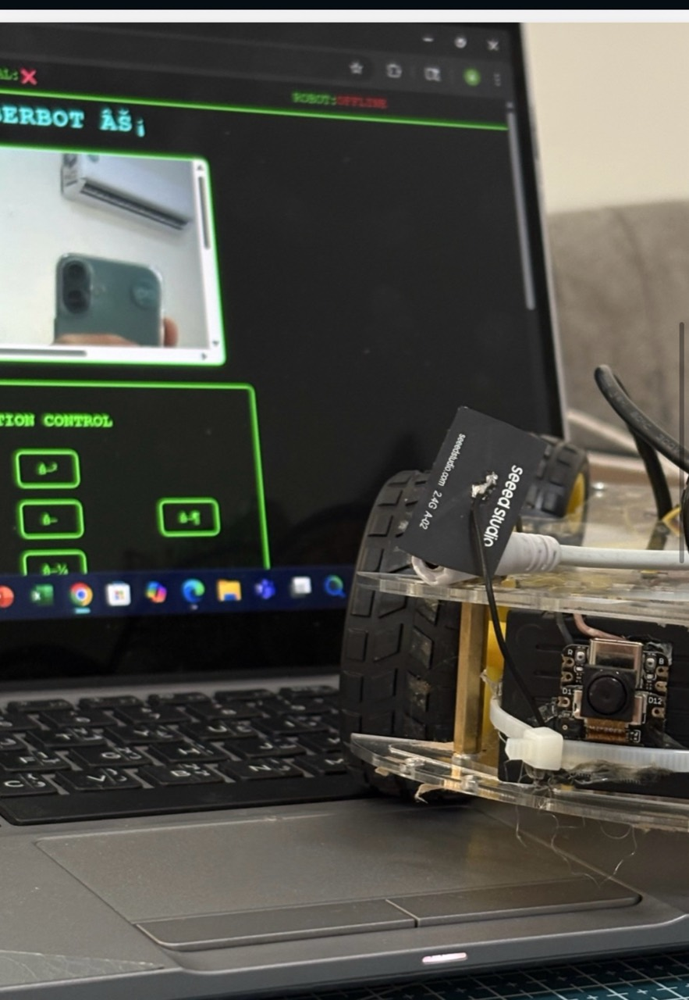

<strong>V O L T R A</strong> ROBOTICS & EMBEDDED SYSTEMS Designed and built by ali9235 · Student engineering portfolio

# AI Vision Robot Platform

**Exploring the boundary between embedded image capture, computer vision, and mobile control.**

This is a separate wheeled robotics project. I report using an ESP32 camera, a second ESP32 for motor control, Wi-Fi communication, and computer-based AI processing. The supplied photographs show a physical camera-equipped platform and a computer interface displaying a camera image and directional controls. They do not establish the exact processing algorithm or verify closed-loop operation.

The engineering focus is the interface between subsystems: what the camera produces, what the computer can infer, and what the motor controller may safely accept. Keeping these responsibilities explicit makes it possible to evaluate perception and motion separately before treating them as an integrated robot behavior.

**Explore:** [Architecture and interface analysis](docs/ENGINEERING_ANALYSIS.md) · [Evidence register](docs/EVIDENCE.md) · [Setup and validation](docs/BUILD_AND_TEST.md)

## Problem statement

Small embedded boards have limited resources for image processing. My objective is to explore a division of work: an embedded camera captures the scene, a computer handles more demanding analysis, and a dedicated controller handles the robot. The aim is a modular platform whose perception and control can be understood and improved independently.

## My contribution

I report independently assembling and integrating the robot, camera, electronics, wireless interface, and computer-side processing. The photographs document my physical prototype and interface arrangement. The exact firmware and vision software for this configuration have not yet been identified, so individual algorithms and successful recognition results are not asserted as verified contributions.

## How it works

The builder-reported design sends images over Wi-Fi to a computer, processes them there, and uses a separate embedded controller for robotic motion. A visible camera module and its external antenna support the imaging/wireless hardware context. The computer photograph shows a camera-image panel and directional-control buttons.

This evidence does not show that a particular vision model ran, what it recognized, or that a button command reached a motor. The camera resembles a compact Seeed/XIAO-style assembly, but the exact module and controller identities must be confirmed. No face identity, recognition score, model accuracy, or measured network latency is inferred.

## System architecture

Dashed arrows denote the reported design. No unverified protocol, port, or GPIO assignment is presented as an established connection.

The pictured launcher is mechanical context and is outside this documented control path.

## Hardware and software

| Subsystem | Evidence |
| --- | --- |
| Mobile platform | Wheeled acrylic-style chassis visible |
| Camera | Camera lens, compact module, and Seeed-labelled antenna visible; exact part unconfirmed |
| Display | Small TFT-labelled display visible; resolution marking visible but operating behavior not demonstrated |
| Controller | ESP-style board visible in the close-up; the reported two-ESP32 configuration needs board identification |
| Power | Battery holders and extensive wiring visible; regulation and power budget unknown |
| Computer interface | Camera-image panel and movement controls visible in a still photograph |
| AI processing | Builder-reported; matching model, source, and evaluation unavailable |
| Mechanical payload | Builder identifies a gel-bead launcher; actuation wiring and functionality are excluded |

No matched firmware is published in this edition. See [source and evidence audit](docs/EVIDENCE.md) and [setup and validation](docs/BUILD_AND_TEST.md).

## Engineering challenges and solutions

| Engineering question | Reported or visible response | Evidence still needed |
| --- | --- | --- |
| Where should image analysis run? | Builder reports computer-side processing | Actual program, dependencies, input/output trace |
| How should imaging and motion be separated? | Builder reports separate camera and motor controllers | Board models and a documented communication contract |
| How does an operator understand the robot? | Camera view and directional controls are pictured | Live camera/control demonstration and failure states |
| How are components packaged? | Boards, display, batteries, and wiring share a compact chassis | Power diagram, cable strain relief, service access |

These observations do not establish that latency, power, or connection-loss issues were solved. Those remain specific validation tasks.

The [engineering analysis](docs/ENGINEERING_ANALYSIS.md) specifies the missing interface contracts and explains why a displayed image, recognition output, and successful motion command require separate validation.

## Development journey

The close-up records the integrated hardware; this second view records the robot beside its interface. No dates or earlier revisions are assigned without additional evidence. The gripper robot belongs to the separate `autonomous-ai-robot` project and is not merged here.

## What I learned

This project explores the boundaries between embedded hardware, networking, computer vision, and physical control. It emphasizes the value of separating subsystem responsibilities, checking board identity before reusing firmware, and documenting the full path from an image to a control decision. Quantitative tests are still needed to turn the integrated prototype into a reproducible platform.

## Real-world impact

A validated version could support education in networked robotics, supervised experiments with computer vision, and research into low-cost remote inspection. The useful focus is sensing and controlled mobility. It is not presented as a security, surveillance, or person-targeting product.

## Safety, privacy, and publication scope

The prototype contains builder-identified gel-bead launcher hardware. This repository documents the sensing/mobile platform only. It includes no firing instructions, targeting-to-actuation path, automatic human targeting, or sensitive facial datasets. Disconnect and remove launcher power for camera, software, and mobility experiments. Keep people clear of moving wheels and mechanisms, and use a supervised bench setup with a physical power cutoff.

See [safety and privacy](docs/SAFETY_AND_PRIVACY.md). Any future source addition must be reviewed against this scope.

## Limitations and future improvements

- Identify the two reported ESP32 boards and match the original source to this exact build.
- Document image transport, command messages, motor-driver wiring, and safe connection-loss behavior.
- Demonstrate the vision algorithm with nonsensitive objects and a reproducible test set.
- Measure stream latency, command latency, and recovery from lost connectivity.
- Document power rails and isolate actuator electrical noise from camera/controller supplies.
- Publish the mobility and perception code only after removing secrets and out-of-scope actuation.

Built by [ali9235](https://github.com/ali9235). A license has not been selected.
